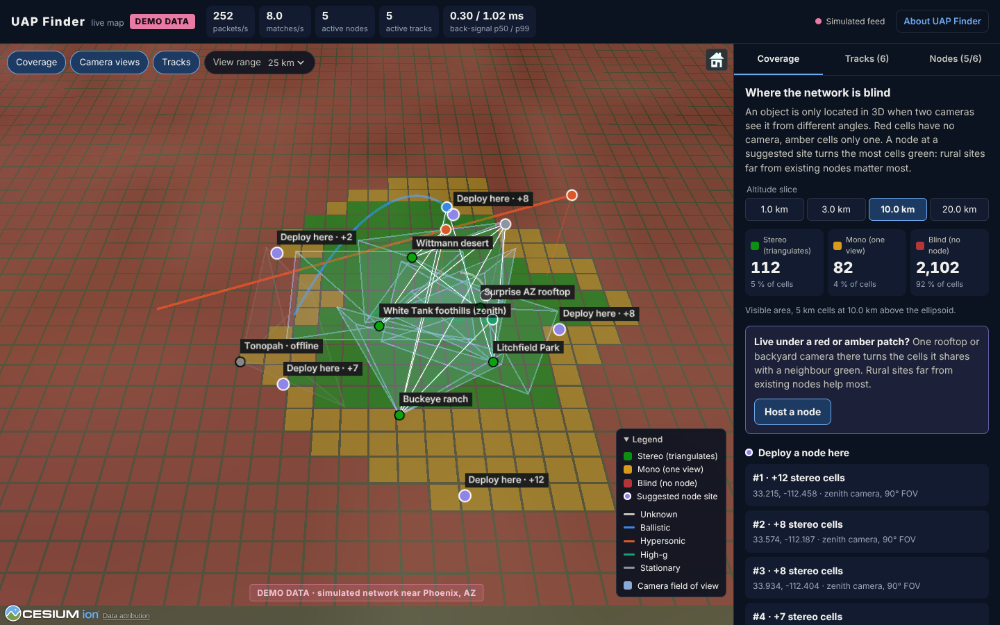

# UAP Finder

A citizen-science network of passive, sky-facing cameras that triangulates
unidentified aerial objects from two or more viewpoints miles apart, turning
sightings into measured 3D tracks with altitude, speed, acceleration and
error bars. Built from the SKY-NET / STEREO-GRID architecture blueprint.



## How it works

```
 Edge node (Jetson Orin Nano, camera, GPS/PPS)          Server                          Web
 ┌────────────────────────────────────────┐   signed   ┌──────────────────────────┐   ┌──────────────────────┐
 │ capture → background model → blobs     │  metadata  │ verify → spatial index   │   │ public site  (/)     │
 │ → tracks → filters (clouds, stars,     │ ─────────▶ │ (80 mi) → match ±50 ms   │──▶│ live 3D map  (/map/) │
 │   birds, ADS-B aircraft) → az/el       │  UDP/HTTPS │ → triangulate → 3D track │   │ volunteer sign-up    │
 │ ring buffer of HD video                │ ◀───────── │ → clip back-signal       │   └──────────────────────┘
 └────────────────────────────────────────┘ clip_request└──────── PostGIS ─────────┘
```

1. Each **edge node** analyses its own 1080p60 video. Clouds, stars, birds,
   insects and aircraft that broadcast ADS-B are filtered out on the device.
   For what remains it sends a small signed packet: direction (azimuth,
   elevation), GPS-timed capture time and position. Video stays on the node.
2. The **server** finds active nodes within 80 miles whose reports fall
   within 50 ms of each other and intersects their lines of sight.
   Successive fixes become a 3D track with speed and acceleration, flagged
   when hypersonic (> Mach 5) or high-g (> 10 g). The first match asks each
   contributing node for a short HD clip.
3. The **website** explains the project, recruits node hosts, and hosts the
   live **3D map** of nodes, camera views, tracks and coverage gaps.

The geometry and error model are in [docs/MATH.md](docs/MATH.md); the
wire format in [docs/PROTOCOL.md](docs/PROTOCOL.md); the HTTP API in
[docs/API.md](docs/API.md).

## Repository

| Path | What | Docs |
|------|------|------|
| `common/` | Shared Python: WGS84 geodesy, camera model, triangulation and error model, signed wire protocol | [MATH.md](docs/MATH.md) |
| `edge/` | Edge node software (Python 3.10+, OpenCV), Jetson provisioning, systemd unit, image notes | [edge/README.md](edge/README.md) |
| `server/` | Ingest, matchmaking, tracks, back-signals, API, PostGIS, benchmarks (Python, FastAPI) | [server/README.md](server/README.md) |
| `dashboard/` | Live 3D map (React, TypeScript, CesiumJS), served at `/map/` | [dashboard/README.md](dashboard/README.md) |
| `site/` | Public website (Astro), served at `/` | [site/README.md](site/README.md) |
| `tools/simulate_network.py` | Virtual nodes with ground-truth targets, scores the server's tracks | |
| `deploy/` | Mac Studio + Tailscale guide, Docker image | [deploy/mac-studio/README.md](deploy/mac-studio/README.md) |
| `scripts/build-web.sh` | Builds site + map into `site/dist` (the Vercel build) | |

## Try it locally

```bash
# Server with a ground-truth simulation (Python 3.10+)
python3 -m venv .venv && .venv/bin/pip install -e ./common -e ./server
.venv/bin/skynet-server keygen                       # → a master key
export SKYNET_MASTER_KEY=<that key> SKYNET_ADMIN_TOKEN=$(openssl rand -hex 24)
export SKYNET_PUBLIC_URL=http://127.0.0.1:8000 SKYNET_CORS_ORIGINS=http://localhost:5173
.venv/bin/skynet-server serve &                       # HTTP :8000, UDP :9999
.venv/bin/python tools/simulate_network.py --udp 127.0.0.1:9999 \
    --api http://127.0.0.1:8000 --master-key "$SKYNET_MASTER_KEY" --duration 30

# Live map against it (Node 22), or add ?demo=1 for built-in demo data
cd dashboard && npm ci && VITE_API_BASE=http://127.0.0.1:8000 npm run dev
```

Simulator output from this repository's own run (6 nodes, 30 s, 0.03°
angular noise):

| Target | Points | Median error | p95 error | Flags raised |
|--------|-------:|-------------:|----------:|--------------|
| Mach 6 straight line at 20 km | 379 | 18 m | 53 m | hypersonic |
| Hover, then 20 g dash at 6 km | 307 | 14 m | 69 m | high_g, hypersonic |
| 216 m/s cruise at 9 km | 306 | 8 m | 18 m | none |

## Deploy

| Option | What runs where | Guide |
|--------|-----------------|-------|
| **Mac Studio + Tailscale + Vercel** (planned) | Server and PostGIS on a Mac at home; nodes reach it over Tailscale (UDP); site and map on Vercel call its API through Tailscale Funnel. No router ports opened. | [deploy/mac-studio](deploy/mac-studio/README.md) |
| Linux VPS | `docker compose up -d --build` (server + PostGIS); site and map on Vercel or any static host | [docker-compose.yml](docker-compose.yml) |
| Vercel only (small pilot) | Site, map and the API as a Vercel Function with Upstash Redis and Neon Postgres; nodes use HTTPS (Vercel cannot receive UDP) | [server/README.md](server/README.md#deploy-on-vercel) |

For the Vercel parts, import this GitHub repository as a project:
`vercel.json` builds the site at `/` and the map at `/map/`. Set
`UAPF_API_BASE` to the server's public URL when the API runs elsewhere.

## Status

Built and tested in this repository's CI-equivalent runs (Linux, x86_64):

* **common**: 47 tests, including WGS84 conversions cross-checked against PROJ
  and a Monte-Carlo check that the error model predicts the observed error.
* **edge**: 132 tests (also run on Python 3.10 with JetPack-like library
  versions), including a synthetic-sky integration test in which only a
  turning point target is reported (direction error ≤ 0.012°) while a
  cloud, a bird and an ADS-B aircraft are filtered. Bench: 60 fps sustained
  at 1080p, 2.6 GB peak memory, on an x86 container.
* **server**: 134 tests, including real Redis and PostGIS. The ground-truth
  simulator passes over UDP and HTTPS, and the Docker Compose stack was run
  end to end (UDP through Docker, migrations, persistence).
* **map**: 75 unit tests, production builds for `/` and `/map/`, verified
  in a browser against the live server (WebSocket feed, tracks, coverage).
* **website**: 37 unit and 50 browser end-to-end tests.

Not verified, because the hardware or services were not available here:

* **Jetson hardware**: CSI camera capture, the CuPy GPU backend, GPS/PPS and
  BNO055 drivers, the systemd unit, image building and flashing, and whether
  the Orin Nano sustains 60 fps (`skynet-edge bench` checks this on the
  device).
* **Deployments**: Vercel (build, routing, Upstash, Neon, WebSockets), and the
  Mac Studio, Tailscale and Funnel steps.
* **Server throughput**: the blueprint asks for 10,000 msg/s with a < 20 ms
  back-signal. On this container's 2.1 GHz core one process matches about
  7,900 msg/s (in-process benchmark) and keeps the back-signal p99 under
  20 ms up to about 3,000 msg/s over UDP. Run
  `server/bench/bench_inprocess.py` on the Mac Studio to measure its
  capacity; [server/README.md](server/README.md#scaling-and-performance)
  describes scaling by region.

## Deviations from the blueprint, and why

* **Timestamps** are nanoseconds as named; the blueprint's example value
  `1782345600000000` is microseconds, so the server rejects values that are
  not 19-digit nanoseconds.
* **Packets are signed** (HMAC-SHA256 per node, keys derived from one server
  master key) and checked for freshness and replay. An open UDP port without
  authentication would let anyone inject fake tracks.
* **Rays, not lines**: an intersection behind either camera is rejected,
  and a gate checks parallax, range, altitude and the miss distance against
  the angular noise model before two sightings count as one object.
* **Three or more nodes** are solved together by weighted least squares, and
  every fix carries a 1-sigma uncertainty from the error model.
* **Edge nodes report every unidentified track, not only "anomalies"**: one
  camera measures angles, not speed. Whether something is hypersonic or
  pulling high g is decided after triangulation, on the server.
* **HTTPS transport** alongside UDP, so nodes work behind restrictive
  networks and with serverless hosting.
* **Privacy**: public node positions are rounded to about 1 km, and public
  lines of sight are recomputed from those rounded positions so they cannot
  be traced back to a volunteer's house.
* **Hardware facts**: the Orin Nano has no hardware video encoder, so clips
  are encoded in software and only for events. Its memory is shared between
  CPU and GPU, so the 7 GB limit covers both. 67 TOPS is the "Super"
  (JetPack 6.2) rating.

## Tests

```bash
.venv/bin/python -m pytest common                 # shared library
server/.venv/bin/python -m pytest server/tests    # server (starts Redis/PostGIS if installed)
edge/.venv/bin/python -m pytest edge/tests        # edge node
(cd dashboard && npm test) && (cd site && npm test && npm run test:e2e)
```

[`.github/workflows/ci.yml`](.github/workflows/ci.yml) runs all of these on
pull requests and pushes to `main`.

## License

No license has been chosen yet. Until one is added, the code is not open
source in the legal sense, even though the website describes the project as
open.
